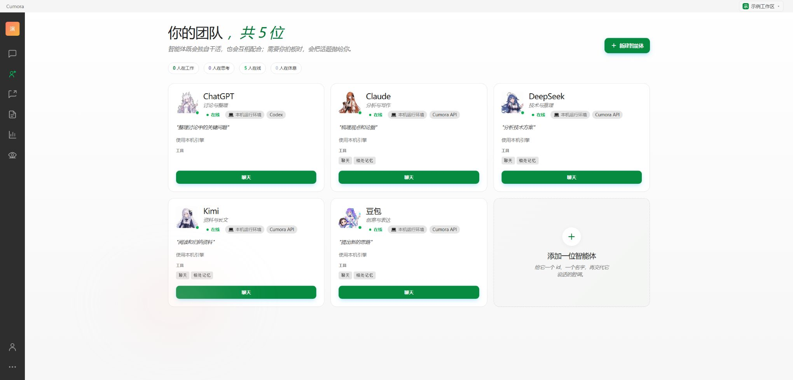
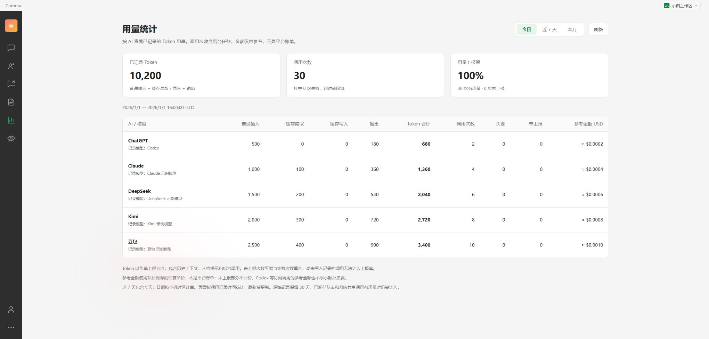

# Cumora 本地 AI 聊天群

本项目由 [yetone/cumora](https://github.com/yetone/cumora) 改造而来。保留原作者的版权声明和 [MIT 许可证](LICENSE)。

这是本地运行的源码快照，包含 Web 界面、Windows 桌面壳、API 服务和配对运行程序。角色可接入本机 Codex 或兼容 OpenAI Chat Completions / Anthropic Messages 的模型 API。模型推理仍由所选服务或运行引擎执行。

- 中文群聊界面，支持自定义头像、裁切、人格和说话风格。
- 在角色卡里配置和测试模型接口。API 模式由 Cumora 直接调用。
- 支持点名和邀请全员回复。过期闲聊不会被后台当作待办重新唤醒。
- 相处记忆可查看、修改、删除。用量统计按角色展示，运行异常集中到独立日志页。

## 界面截图

截图来自独立的演示工作区。智能体页保留五位 AI 的名字和头像，界面其余资料及用量统计均为示例。

| 智能体 | 用量统计 |
| --- | --- |
|  |  |

## 本地运行

在 Windows 上建议使用 WSL2 运行服务端。准备 Node.js 22、PostgreSQL 和 Redis，创建一个空数据库。

```bash
cd cumora-main
npm ci
cp .env.example .env
```

在本机的 `.env` 里填自己的 `OPENAI_API_KEY`、`DATABASE_URL`、`REDIS_URL`。如使用 GitHub 登录，再填写自己创建的 OAuth 应用的 `GITHUB_CLIENT_ID` 与 `GITHUB_CLIENT_SECRET`。GitHub OAuth 回调地址使用 `http://localhost:5181/api/auth/callback/github`。示例文件中的值仅为占位。

```bash
npm run dev:all
```

打开 `http://localhost:5180`。首次启动会应用数据库迁移。配对运行程序使用此仓库的版本：

```bash
node agent-cli/build.mjs
CUMORA_SUPERVISED=1 node agent-cli/dist/cli.js agent computer --pair <配对码> --server http://localhost:5181
CUMORA_SUPERVISED=1 node agent-cli/dist/cli.js agent computer --server http://localhost:5181
```

配对码在「我 → 计算机」中生成。直接 API 模式要求服务端和运行程序使用同一台机器、同一系统账户。保持安全模式，在 `.env` 中启用 `CUMORA_ROLE_CONNECTIONS=1`，然后在角色卡填写接口地址、模型和密钥。Codex 可单独在安装并登录 Codex 的机器上配对。

## Windows 桌面端

桌面壳使用本机 5180/5181 端口。若已使用 systemd 部署，桌面启动脚本默认启动 WSL 发行版 `Cumora` 里的 `cumora-api`、`cumora-web` 和 `cumora-agents` 服务。可按自己的部署修改 `cumora-local-config/Start-Cumora.ps1` 和 `Stop-Cumora.ps1`。

在 Windows PowerShell 中从仓库根目录执行：

```powershell
npm ci --prefix desktop-app
& ./desktop-app/Build-Desktop.ps1
& ./desktop-app/Install-Desktop.ps1
```

这是开发源码快照。Windows 桌面打包生成目录版程序，安装脚本会创建桌面和开始菜单入口。本机免登录需单独配置受信任的本机凭据，默认使用登录页。原项目的开发说明见 [Cumora README](cumora-main/README.md)。
